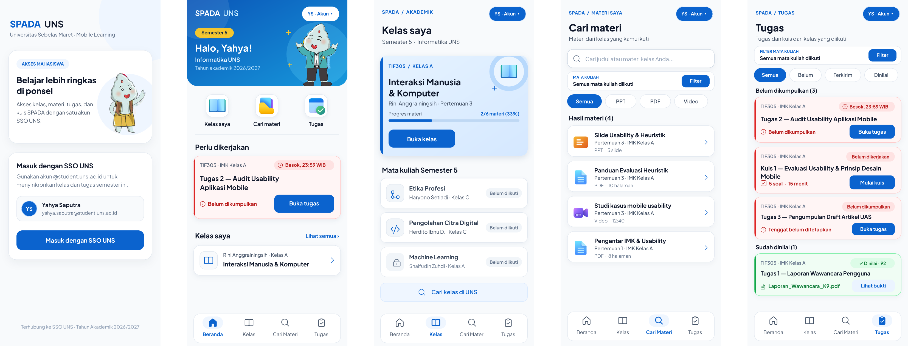
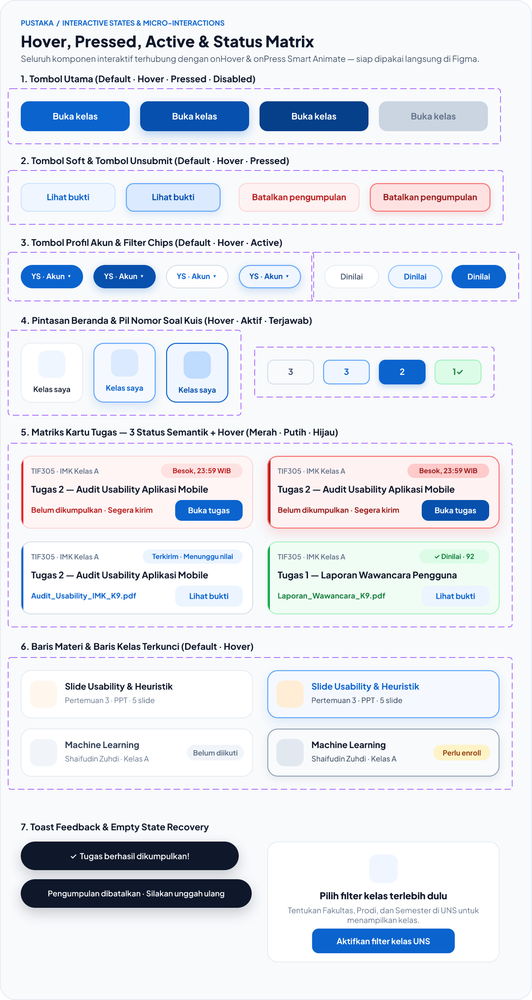
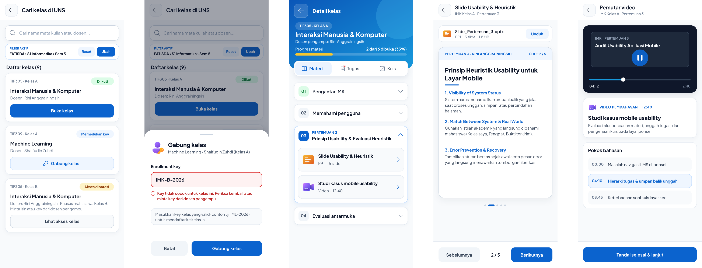
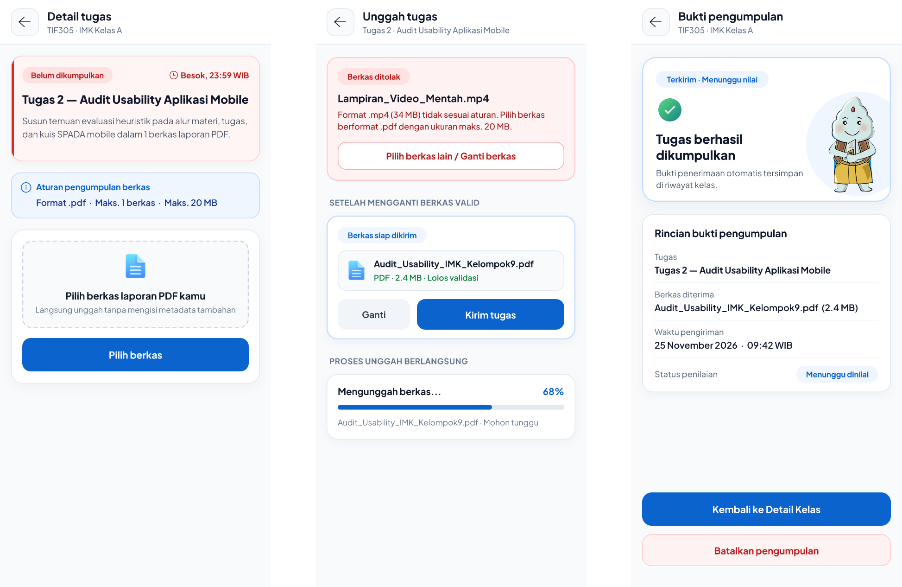
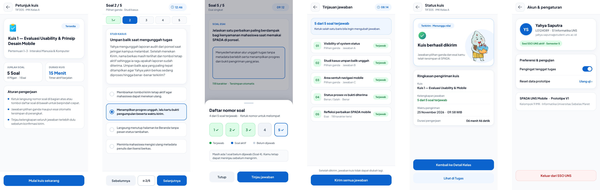
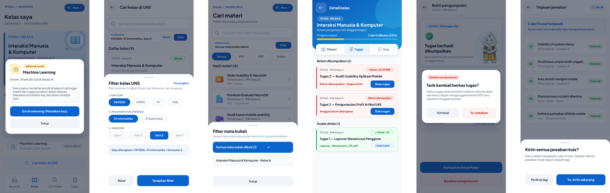

# SPADA UNS Mobile

> Clean, thumb-friendly mobile learning redesign and interactive HTML prototype for **Universitas Sebelas Maret (UNS)** students — **Human-Computer Interaction (IMK)** Final Project, Team 9.

[](https://spada-uns-mobile-prototype.vercel.app/)
[-0B63CE?style=flat-square)](design/README.md)
[](design/README.md)
[](docs/research/Daftar_Pertanyaan_UEQ_Evaluasi_V1.md)

**[Try Live Interactive Prototype](https://spada-uns-mobile-prototype.vercel.app/)** · **[Design System & 25-Screen Spec](design/README.md)** · **[Product Specification](docs/research/product-specification.md)** · **[UX Research & Audit](docs/research/Handoff%20Riset%20UX%20SPADA%20UNS%20Mobile.md)**



---

## 1. Problem Statement & UX Audit

Students accessing the existing **SPADA UNS** web LMS on smartphones frequently run into deep navigation hierarchies, hard-to-scan assignment deadlines, multi-step file upload friction, cramped quiz interfaces, and ambiguous course catalog enrollment states.

Through **user interviews**, a **21-screen as-is audit** (`docs/benchmarks/SS Spada/`), and a **24-screen interaction benchmark** against **Ruangguru Mobile** (`docs/benchmarks/SS Ruang Guru Mobile/`), Team 9 distilled **five core user needs (`K01–K05`)**:

- **`K01` Fast Material Access:** Reduce taps to reach lecture slides (`PPT`/`PDF`) and discussion videos via collapsible meeting accordions and cross-course material search.
- **`K02` Scannable Deadlines & Status:** Surface upcoming tasks upfront with explicit badges—including `"Tenggat belum ditetapkan"` when no deadline is set.
- **`K03` Resilient File Upload & Recovery:** Show file rules upfront (`.pdf`, max 20 MB), provide immediate validation feedback on wrong files, show upload progress, and render a clear submission receipt card.
- **`K04` Comfortable Mobile Quiz Experience:** Support long case-study stems, `≥ 44×44 px` touch targets, a live timer, a question-number bottom sheet drawer, and spacious essay inputs.
- **`K05` Clear Course Identity & Access States:** Distinguish similar course classes (`IMK Kelas A` vs `Kelas B`) across three explicit catalog states (*Enrolled*, *Enrollment Key Required*, and *Restricted Access*).

---

## 2. Design System & Visual Direction

Built end-to-end as a **Light-only Figma Design System** mapped **1:1** into CSS Custom Properties ([`prototype/styles/tokens.css`](prototype/styles/tokens.css)):

- **Color Identity:** Calm neutral canvas (`#F8FAFC`) and elevated white cards (`#FFFFFF`), anchored by signature **SPADA UNS Blue** (`#0B63CE`) and subtle **UNS Gold** (`#F4C62F`) accents, plus muted semantic status pills (Success `#15803D`, Warning `#92400E`, Danger `#B91C1C`).
- **Typography & Accessibility:** `Plus Jakarta Sans` scale (`H1 24px` down to `Eyebrow 11px`), mandatory **`44×44 px`** minimum touch targets, non-color-dependent status cues, and an optional **Large Reading Scale** toggle in `S15 · Account & Settings`.

Explore the complete token tables and component guidelines in **[`design/README.md`](design/README.md)**.



---

## 3. Hi-Fi Screen Showcase (25 Frames · `390×844`)

### Course Catalog, Course Detail & Material Viewers (`S04`, `S07`, `S08`, `S09`)


### Assignment Upload, Error Recovery & Submission Receipt (`S10 · Scenario T3`)


### Mobile Quiz Flow (MCQ + Long Case + Essay) & Account Settings (`S11–S15 · Scenario T4`)


### Supporting Empty, Enrollment Key & Confirmation States


---

## 4. Interactive Prototype & Usability Test Scenarios (`T1–T4`)

The **[Live Prototype](https://spada-uns-mobile-prototype.vercel.app/)** is a zero-dependency, 100% client-side mobile-first web app (`max-width: 430px; min-height: 100dvh`) with **`localStorage` state persistence**, instant state reset, and a built-in **"Panduan uji T1–T4"** checklist accessible from **Akun & pengaturan** (`YS · Akun ▾`).

| Scenario | User Goal Verified in Prototype | Key Interactive Capabilities |
| --- | --- | --- |
| **T1 · Lecture Slides** | Locate `IMK — Kelas A` and open Meeting 3 PPT slides | Collapsible meeting accordion, slide-by-slide mobile viewer, download toast |
| **T2 · Discussion Video** | Locate and play Meeting 3 mobile usability video | Interactive mock video player (play/pause, seek bar, elapsed duration) |
| **T3 · Assignment Upload** | Trigger invalid file error, recover with valid PDF, submit & verify receipt | Real `<input type="file">` + quick dummy files, error banner, 0–100% upload bar, timestamped receipt card |
| **T4 · Mobile Quiz** | Complete 5-question quiz (MCQ + long case + essay), jump via drawer, review & submit | Live `15:00` timer, question-number bottom sheet, essay textarea counter, review & confirmation screen |
| **Supporting Flows** | Enroll via catalog key & discover cross-course materials | 3 catalog access states, enrollment key validation, real-time search + `PPT`/`PDF`/`Video` filter chips + empty state |

### Run Locally
No build step is required—serve the `prototype/` directory with any static server:
```bash
npx serve prototype
# or open prototype/index.html directly in a mobile viewport (390×844)
```

---

## 5. Usability Evaluation Framework (UEQ V1)

Post-prototype evaluation with UNS students combines task-completion tracking (`T1–T4`, Course Enrollment, Explore Materials) with an adapted **33-item Mobile Learning UEQ instrument** based on **Kumar & Chand (2024)** using **Nielsen's (1995) 1–4 severity scale**, grounded in **Huang & Benyoucef's** mobile usability guidelines:

- Evaluation Questionnaire Spec: [`docs/research/Daftar_Pertanyaan_UEQ_Evaluasi_V1.md`](docs/research/Daftar_Pertanyaan_UEQ_Evaluasi_V1.md)
- Reference Papers: [`docs/research/`](docs/research/)
- Team 9 Final Project Article Workspace: [`docs/article/`](docs/article/)

---

## 6. Repository Structure

```text
spada-uns-mobile/
├── docs/
│   ├── research/        # UX research handoff, locked product spec, UEQ instrument & papers
│   ├── benchmarks/      # 21 as-is SPADA UNS screenshots & 24 Ruangguru UI benchmarks
│   └── article/         # Team 9 HCI final project article outline & PR collaboration guide
├── design/
│   ├── previews/        # 6 high-res exported sheets covering all 25 Hi-Fi screens & states
│   └── README.md        # Light-theme Figma Design System tokens, typography & component spec
├── prototype/
│   ├── assets/          # Custom academic SVG icons & UNS mascot illustrations
│   ├── styles/          # 1:1 design tokens (tokens.css) & mobile-first layout (app.css)
│   ├── js/              # Locked dataset (data.js), localStorage state (state.js) & router (app.js)
│   └── index.html       # Mobile-first prototype entry point
├── .gitignore
└── README.md
```

---

## 7. Team & Academic Attribution

Developed by **Team 9 — Informatics, Universitas Sebelas Maret (UNS)** for the **Human-Computer Interaction (IMK)** Final Project (2026). All student profiles (`Raka Pratama`, `M0522048`), course rosters, assignments, and quiz items in the prototype are synthetic dummy data created strictly for usability testing.
