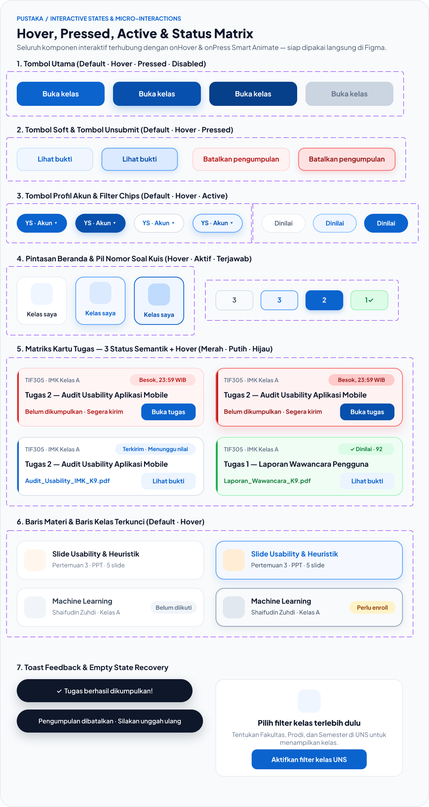
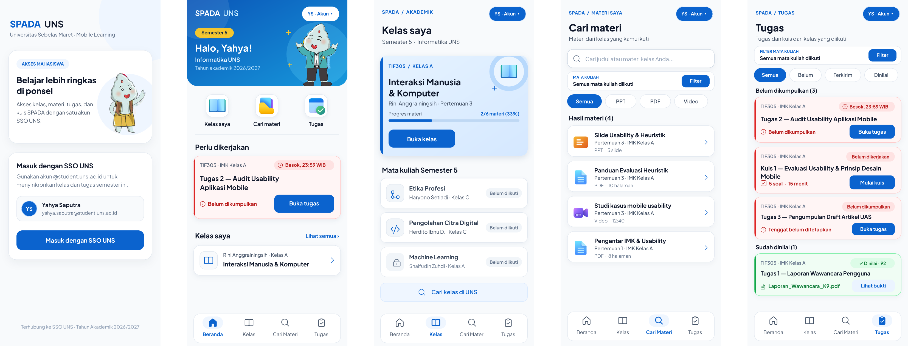
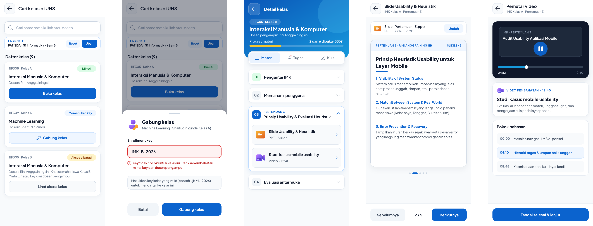
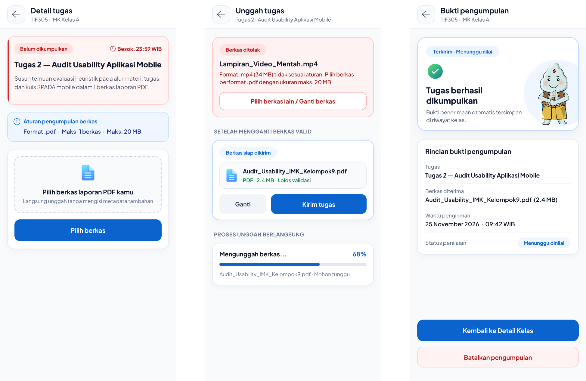
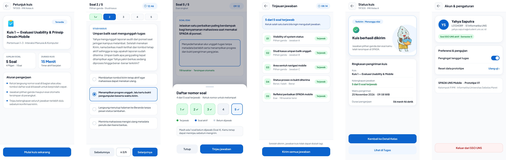
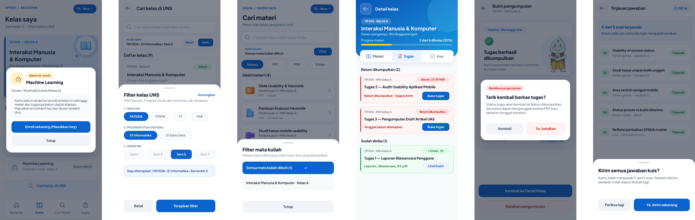

# SPADA UNS Mobile — Design System & Hi-Fi Screens

**Theme:** Light Only · **Viewport:** Mobile-First (`390×844`, responsive up to `430px`) · **Typography:** Plus Jakarta Sans  
**Workflow:** UX Research → Figma Design System (Variables & Components) → 25 Hi-Fi Screens → 1:1 CSS Custom Properties (`prototype/styles/tokens.css`)

---

## 1. Visual Direction

- **Clean Light UI:** Calm neutral light surfaces (`#F8FAFC` canvas, `#FFFFFF` cards) to maximize readability for long quiz prompts, academic materials, and assignment instructions on small screens.
- **SPADA UNS Brand Identity:** Uses SPADA signature blue (`#0B63CE`) as the primary action accent paired with subtle UNS gold highlights (`#F4C62F`), avoiding dense full-blue legacy screens.
- **Ergonomics & Accessibility:**
  - Minimum interactive touch target: **`44×44 px`** (`--touch-min`).
  - Optional reading text scale (`[data-text-scale="large"]`) controllable from `S15 · Account & Settings`.
  - Status cues combine icon, text label, and calm tinted pills (never color alone).

---

## 2. Design Tokens (Light Theme)

### Color Palette

| Category | Token | Hex | Role |
| --- | --- | --- | --- |
| **Canvas & Surface** | `--bg-canvas` | `#F8FAFC` | App background canvas |
| | `--bg-surface` | `#FFFFFF` | Primary cards, headers, sheets |
| | `--bg-surface-subtle` | `#F1F5F9` | Recessed containers & inputs |
| **Text Hierarchy** | `--text-primary` | `#0F172A` | Headings & primary copy |
| | `--text-secondary` | `#475569` | Body & supporting copy |
| | `--text-muted` | `#64748B` | Captions, metadata, timestamps |
| | `--text-placeholder` | `#94A3B8` | Input placeholders |
| **Borders** | `--border-subtle` | `#E2E8F0` | Default card & divider strokes |
| | `--border-strong` | `#CBD5E1` | Interactive control borders |
| | `--border-brand` | `#BFDBFE` | Highlighted brand containers |
| **Brand (SPADA UNS)** | `--brand-spada-blue` | `#0B63CE` | Primary CTA, active tab, links |
| | `--brand-spada-dark` | `#0A56B8` | Pressed/hover primary state |
| | `--brand-spada-cyan` | `#1799DC` | Secondary accent highlight |
| | `--brand-spada-soft` | `#EFF6FF` | Soft brand surface tint |
| | `--brand-uns-gold` | `#F4C62F` | Academic badge / mascot accent |
| **Semantic Status** | `--status-success` / soft | `#15803D` / `#DCFCE7` | Submitted, enrolled, completed |
| | `--status-warning` / soft | `#92400E` / `#FEF3C7` | Upcoming deadlines, pending |
| | `--status-danger` / soft | `#B91C1C` / `#FEE2E2` | Validation errors, restricted access |

### Typography Scale (`Plus Jakarta Sans`)

| Token | Default Size | Large Reading Scale | Usage |
| --- | --- | --- | --- |
| `--text-h1` | `24px` | `24px` | Primary screen greeting / hero title |
| `--text-h2` | `18px` | `18px` | Section & contextual header title |
| `--text-h3` | `15.5px` | `15.5px` | Card titles & quiz headers |
| `--text-body` | `14px` | `15.5px` | Body copy, instructions, quiz stems |
| `--text-caption` | `12px` | `13px` | Metadata, deadlines, badges |
| `--text-eyebrow` | `11px` | `11px` | Course codes & section eyebrows |

### Spacing, Radii & Elevation

- **Spacing Grid (4 / 8 px):** `--space-1` (`4px`), `--space-2` (`8px`), `--space-3` (`12px`), `--space-4` (`16px`), `--space-5` (`20px`), `--space-6` (`24px`).
- **Corner Radii:** Small `10px`, Medium `12px` (buttons/inputs), Large `16px` (cards), XL `20px` (modals/sheets), Hero `26px`, Pill `999px`.
- **Elevation:** Soft neutral shadows (`--shadow-xs` through `--shadow-sheet`) tuned for crisp separation on Light surfaces without visual heaviness.

---

## 3. Hi-Fi Screen Previews (25 Frames · `390×844`)

All frames are bound 1:1 to the Light Design System tokens above and cover the full `S01–S15` inventory plus interactive error, loading, empty, and confirmation states.

### Interactive Component States (Page 2)

### Row 1 — Core Navigation & Auth (`S01`, `S02`, `S03`, `S05`, `S06`)

### Row 2 — Course Catalog, Detail & Materials (`S04`, `S07`, `S08`, `S09`)

### Row 3 — Assignment Upload & Error Recovery Flow (`S10 · T3`)

### Row 4 — Mobile Quiz Flow & Account Settings (`S11–S15 · T4`)

### Row 5 — Supporting Empty, Enrollment & Confirmation States

